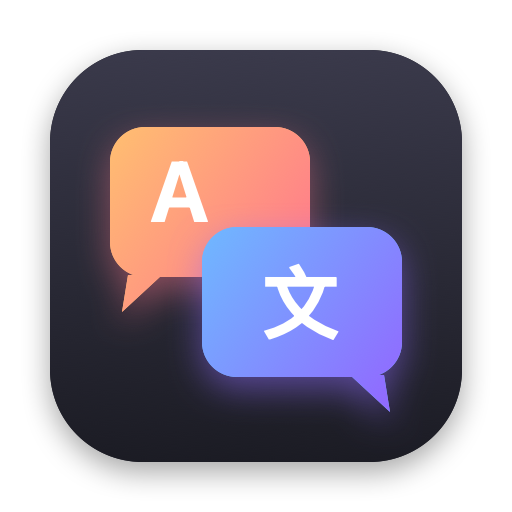

<p align="center"></p>

<h1 align="center">Parla</h1>

<p align="center">Translate selected text in any app on macOS — and draft replies in the sender's language.</p>

## Install / update

```bash
curl -fsSL https://raw.githubusercontent.com/pelinoleg/parla/main/install.sh | bash
```

Requires macOS 14+. On first launch, allow **Accessibility** access (Parla reads the selected text and pastes translations back),
then add at least one API key in Settings.

## Ways to translate

Each one can be switched off in Settings:

- **Shortcut** — select text, press **⌃⌥T** (configurable).
- **⌘C twice** — copy the same thing twice quickly.
- **Button** — a small bubble appears next to freshly selected text.
- **Right-click → Services → Translate with Parla.**

The card shows the translation as it streams in. Switch the target language with the chips (RO · RU · ES · CA · EN · more),
then **↩ Copy**, **⌘↩ Replace** (pastes over your selection) or **Reply**.

**Reply** — type what you want to answer in any language; Parla writes it in the language of the original message,
in a matching tone, and shows it back in your language so you can check it before pasting.

## Translators

Tried in order, falling back to the next on errors or a missing key (order is configurable):

1. **Claude** (default `claude-opus-5-5`)
2. **OpenAI** (default `gpt-5-mini`)
3. **DeepSeek** (default `deepseek-chat`)
4. **Apple** on-device translation (macOS 26+, offline, no Catalan)

Keys are stored in the macOS Keychain. Model names are editable.

Default target is Romanian; if the text is already Romanian it goes to Spanish. Both configurable.

## Build

```bash
./build.sh   # → dist/Parla.app, dist/Parla.zip (ad-hoc signed)
```

Releases are built by GitHub Actions on a `vX.Y.Z` tag and signed with a stable self-signed certificate
(`SIGN_P12_BASE64` / `SIGN_PASS` secrets), so macOS keeps the Accessibility permission across updates.
